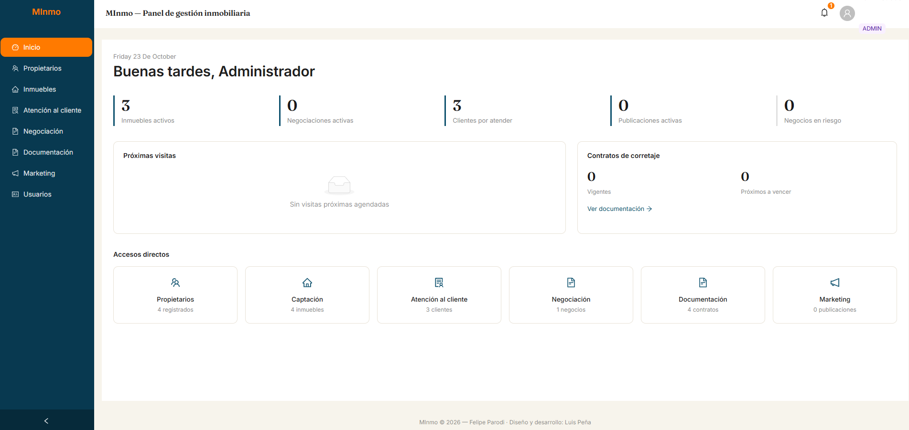
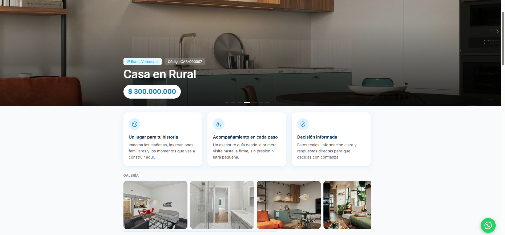

<div align="center">

# MInmo — CRM inmobiliario

**Sistema de gestión para un asesor inmobiliario independiente, en producción.**
Acompaña cada inmueble desde la captación hasta la firma del acta de entrega y genera automáticamente los documentos legales del proceso.

[](https://github.com/LuisPR1050/minmo-crm/actions/workflows/ci.yml)




</div>

---

## El problema

Un asesor inmobiliario independiente maneja propietarios, inmuebles, clientes, visitas, negociaciones y una cadena de documentos legales (contrato de corretaje, promesa de compraventa, otrosíes, recibos, acta de entrega). MInmo reúne el proceso completo en un solo sistema: elimina el trabajo manual de redactar los documentos legales, da trazabilidad completa a cada negociación y queda preparado para escalar a varios asesores.

## Funcionalidades

| Módulo | Qué resuelve |
| --- | --- |
| **Captación** | Propietarios, inmuebles con código único, características, checklist jurídico, visitas de captación, fotos y videos, aliados referenciadores. |
| **Atención al cliente** | Pipeline de leads, requerimientos, agenda de visitas, resultados y objeciones, notificaciones por SMS. |
| **Negociación** | Partes, bienes asociados, plan de pagos, distribución y proyección de gastos de escrituración, historial y cierre automático del negocio. |
| **Documentación** | Contrato de corretaje, promesa de compraventa, otrosíes, recibos de pago y acta de entrega, con generación de PDF y numeración consecutiva. |
| **Marketing** | Publicaciones por portal y red social, recepción de leads de portales por webhook, generación de video-slideshow con texto y voz en off. |
| **Autenticación** | Login con JWT, roles `ADMIN` y `ASESOR`, gestión de usuarios y cambio de contraseña. |

Incluye además una **landing pública por inmueble**, con vista previa para WhatsApp y Facebook.



## Arquitectura

**Monolito modular** en Java 21 + Spring Boot, pensado para que lo mantenga un solo desarrollador sin perder orden. Cada módulo de dominio tiene sus propias capas:

```
backend/src/main/java/com/felipeparodi/crmbackend/
├── auth/              seguridad, JWT y usuarios
├── captacion/         ┐
├── atencioncliente/   │  cada módulo:
├── negociacion/       │  controller → service → repository → entity
├── documentacion/     │  + dto (contratos de la API)
├── marketing/         ┘
└── config/            almacenamiento, IA, CORS, manejo global de errores
```

- **API REST** con 77 controladores, documentada con OpenAPI/Swagger.
- **Base de datos versionada**: 49 migraciones con Flyway; Hibernate solo valida el esquema (`ddl-auto=validate`), nunca lo modifica.
- **Decisiones de arquitectura documentadas** en [`docs/adr`](docs/adr), con la visión y el roadmap por fases en [`docs`](docs).
- **Despliegue en un solo contenedor**: Dockerfile multi-etapa que compila el frontend, lo embebe en el jar de Spring Boot y genera una imagen final con usuario sin privilegios.

## Seguridad

- Autenticación sin estado con **JWT** y autorización por roles con **Spring Security**.
- **Cero credenciales en el código**: claves, base de datos e integraciones se leen de variables de entorno.
- Swagger se desactiva en producción (`SPRINGDOC_ENABLED=false`) para no exponer la forma de la API.
- Errores sin stacktrace hacia el cliente (`include-stacktrace=never`) y manejo global de excepciones.
- Webhook de portales protegido con secreto compartido en el encabezado `X-Webhook-Secret`.
- CORS restringido a orígenes configurados explícitamente.
- Archivos protegidos: las imágenes privadas se piden con el token, no por URL pública.

## Pruebas

- **Pruebas unitarias** (JUnit 5 + Mockito) de servicios y generadores de numeración de documentos.
- **Pruebas BDD con Cucumber**, con escenarios escritos en español sobre reglas de negocio reales:
  - Cierre automático de una negociación
  - Registro de pagos
  - Recepción y validación de leads desde portales
- **Integración continua** con GitHub Actions: compila y prueba el backend contra PostgreSQL 16 real, y hace lint y build del frontend en cada push.

## Stack

| Capa | Tecnologías |
| --- | --- |
| Backend | Java 21, Spring Boot 4, Spring Security, Spring Data JPA, Bean Validation, Lombok |
| Base de datos | PostgreSQL 16, Flyway |
| Frontend | React 19, TypeScript, Vite, Ant Design, React Router, Axios |
| Integraciones | Anthropic (IA generativa), Twilio (SMS), almacenamiento compatible con S3 (Cloudflare R2), OpenPDF, FFmpeg |
| Calidad | JUnit 5, Mockito, Cucumber, Oxlint, GitHub Actions |
| Infraestructura | Docker (multi-stage), Docker Compose, Railway |

## Ejecutar en local

**Requisitos:** Java 21, Node.js 22 y Docker.

```bash
# 1. Base de datos
docker compose up -d

# 2. Backend (http://localhost:8080 · Swagger en /swagger-ui.html)
cd backend
export JWT_SECRET=$(openssl rand -base64 48)
./mvnw spring-boot:run

# 3. Frontend (http://localhost:5173)
cd ../frontend
npm install
npm run dev
```

Al primer arranque se crea un usuario administrador y su contraseña se imprime una sola vez en el log, salvo que definas `ADMIN_PASSWORD_INICIAL`.

Las integraciones (IA, SMS, R2, voz en off) son **opcionales**: si sus variables están vacías, la función se desactiva y la aplicación arranca igual. La lista completa de variables está en [`application.properties`](backend/src/main/resources/application.properties).

## Autor

Diseño y desarrollo: **Luis Peña** — Desarrollador de software · Bogotá, Colombia
[LinkedIn](https://www.linkedin.com/in/luis-alberto-pe%C3%B1a-ruidiaz-a6b4092aa) · [GitHub](https://github.com/LuisPR1050) · [LURQEN](https://lurqen-web.vercel.app/)

> Proyecto real desarrollado para *Felipe Parodi Asesor Inmobiliario*. Este repositorio es una copia de presentación del código; la versión en producción se mantiene en un repositorio privado.
